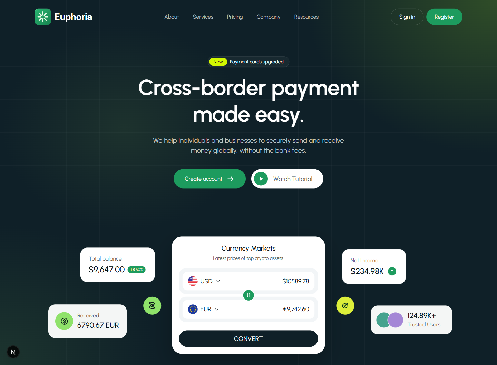
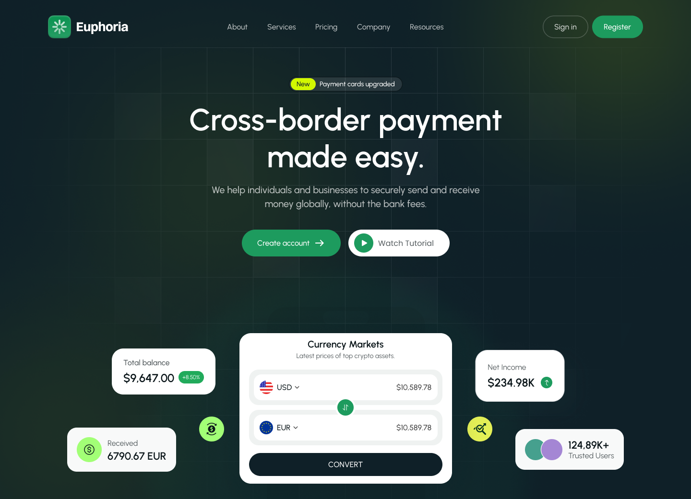

# Euphoria: Banking SaaS Landing Page

A Figma design rebuilt as a responsive, production-ready landing page with Next.js 16, React 19, TypeScript and Tailwind CSS v4.

**Live demo:** https://YOUR-LINK.vercel.app



## About this project

I converted a Figma Community design into code, matching its layout, typography, spacing and colors section by section against the original frames (1440px desktop, 1240px content width, 120px section rhythm). The design only included a desktop version, so I designed the tablet and mobile layouts myself.

| Figma design | Built page |
| --- | --- |
|  |  |

## Features

- **11 sections:** hero, partners, features, currencies, how it works, stats, pricing, smart banking, testimonials, call to action and footer
- **Working currency converter:** type an amount, swap currencies
- **Monthly / yearly pricing toggle**
- **Accessible accordion** with keyboard support and proper ARIA attributes
- **Infinite testimonial marquee** that pauses on hover and respects reduced-motion settings
- **Mobile navigation menu** (closes with Escape)
- **Fully responsive** from 360px to 1440px+, with no horizontal scrolling
- **Static rendering** for fast loading and good SEO, with Google Fonts self-hosted through `next/font`

## Tech stack

Next.js 16 (App Router), React 19, TypeScript, Tailwind CSS v4. No UI library: every component, icon and illustration is built in code.

## Project structure

```
app/
  layout.tsx      fonts (Urbanist, Inter) and page metadata
  page.tsx        section order
  globals.css     design tokens (colors, fonts) and background patterns
components/
  Hero.tsx, Navbar.tsx, CurrencyConverter.tsx
  Partners.tsx, Features.tsx, Currencies.tsx, HowItWorks.tsx, Stats.tsx
  Pricing.tsx, SeamlessBanking.tsx, Testimonials.tsx, CallToAction.tsx, Footer.tsx
  ui.tsx          shared pieces: section badge, buttons, stars, avatars
  icons.tsx, Flags.tsx, Logo.tsx
```

## Run locally

```bash
npm install
npm run dev
```

Open http://localhost:3000.

## Credits

Design: [Banking SaaS Landing Page Design](https://www.figma.com/community/file/1430610446705043896) by sajiburuxui, licensed under [CC BY 4.0](https://creativecommons.org/licenses/by/4.0/). Brand names and logos in the design are fictional placeholders.
